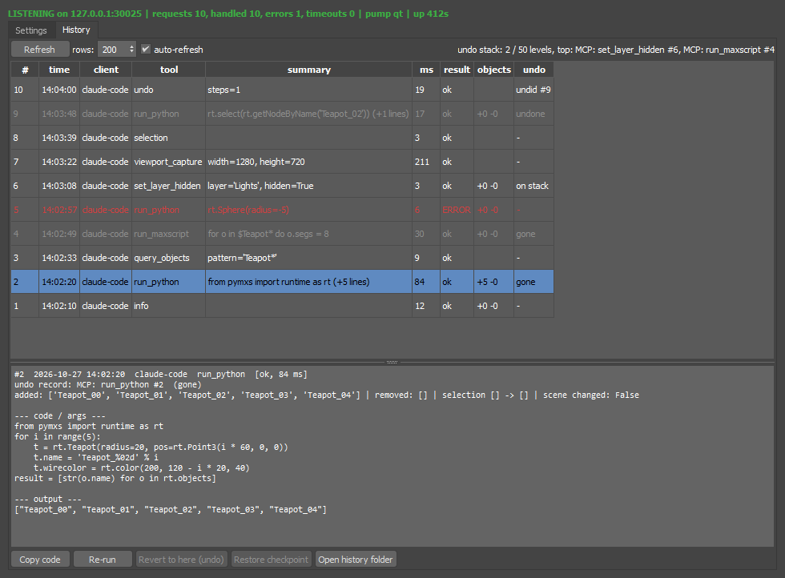

# max-mcp

**Let an AI assistant work inside your running Autodesk 3ds Max session, and keep
the user in control of what it changed.**

max-mcp is an [MCP](https://modelcontextprotocol.io) server for 3ds Max. Any MCP
client (Claude Code, Claude Desktop, Cursor, Gemini CLI, ChatGPT developer mode,
custom agents over HTTP) can read the selection, query objects and layers, grab
the viewport, and run MAXScript or Python (pymxs) in the live scene. Every
request is logged, every scene change is a named undo record, and the AI can
only undo its *own* steps.

> **Why this project** - archviz work in 3ds Max is full of repetitive
> scene surgery (renaming, layer sorting, batch property edits, checks) that an
> assistant can do well, but only if it sees the *open* scene and the user can
> audit and reverse what it did. Headless batch scripts can't see the open scene;
> most bridges give the AI a raw "run script" tool and nothing else. max-mcp is
> the small, model-agnostic layer in between. It is also a portfolio piece.


*The max-mcp window inside 3ds Max: History tab with per-request undo state, scene diff and the code that ran.*

## How it works

| Piece | Runs in | Depends on |
|---|---|---|
| `max_side/` (listener, settings/history window) | 3ds Max (its own Python 3.11) | `pymxs`, standard library, Max's bundled PySide6 |
| `max_mcp/` (`server.py`, `client.py`, `config.py`) | your Python 3.10+ | official `mcp` SDK, standard library |

The listener accepts newline-delimited JSON on `127.0.0.1:30025`; the MCP server
(stdio or streamable HTTP) forwards tool calls to it. Commands run on Max's main
thread (see below). **The bridge never saves your scene** and has no save tool.

Tested with 3ds Max 2025 (Python 3.11.8, PySide6 6.5.3). Other versions that
ship `pymxs` + PySide6 should work but are untested.

## Install

```bash
git clone <repo-url> max-mcp
cd max-mcp
pip install .            # or pip install -e .   (editable)
# without installing:    uvx --from . max-mcp
```

Nothing is installed into 3ds Max; the listener only needs its folder on
`sys.path`, which the start script does by itself.

### 1. Load it inside 3ds Max

**Scripting > Run Script...** and pick `max_side/max_mcp_start.ms`. The
MAXScript Listener prints `[MaxMcp] dinleniyor 127.0.0.1:30025` and the window
is available as macroScript **MaxMcp Settings** (category `max-mcp`, add it to
any menu/toolbar/quad via *Customize > Customize User Interface*), or with
`python.Execute "import max_mcp_ui; max_mcp_ui.show()"`.

To load it automatically at startup, press **Install loader** in the window
(writes a one-line `max_mcp_loader.ms` into Max's per-user startup folder;
**Remove loader** deletes it) or use the CLI:

```bash
python -m max_mcp.paths            # shows detected paths and the loader text, writes nothing
python -m max_mcp.paths --write    # writes the loader
```

Whether the listener actually starts at startup is the **autostart** setting.

### 2. Register the MCP server in your client

The window's *Client configuration* box generates these for your current
port/key (press Copy). Defaults shown; replace `python` with the interpreter
that has `mcp` installed.

**Claude Code**
```bash
claude mcp add -s user max -- python -m max_mcp.server
# HTTP transport:
claude mcp add -s user --transport http max http://127.0.0.1:30026/mcp
```

**Claude Desktop** (`claude_desktop_config.json`), **Cursor** (`.cursor/mcp.json`
or global MCP settings), **Gemini CLI** (`~/.gemini/settings.json`) - all use
the same `mcpServers` shape:
```json
{ "mcpServers": { "max": { "command": "python", "args": ["-m", "max_mcp.server"] } } }
```
Gemini CLI's HTTP form uses `"httpUrl": "http://127.0.0.1:30026/mcp"`; Cursor's
uses `"url"`. These shapes follow each vendor's public docs at the time of
writing but were **not verified** by running those clients here; only Claude
Code and the official `mcp` Python client were tested.

**HTTP / remote clients (ChatGPT developer mode, OpenAI/xAI remote MCP tools,
custom agents)** - run the HTTP transport and point the client at the URL:
```bash
python -m max_mcp.server --transport http                 # http://127.0.0.1:30026/mcp
python -m max_mcp.server --transport http --http-host 0.0.0.0 --key <secret>   # LAN; key mandatory
```
With a key, clients must send `Authorization: Bearer <secret>`. Hosted services
need the URL to be reachable from the internet (a tunnel such as ngrok or
cloudflared, over HTTPS) - **not verified** here, and exposing Max's script
execution to the internet is your risk to take.

## Configuration

Settings live in `%LOCALAPPDATA%\max-mcp\config.json` (override the path with
`MAX_MCP_CONFIG`) and are edited in the window. Precedence, highest first:
**environment variable > command-line argument > config file > default**.

| Key | Env | Default | Meaning |
|---|---|---|---|
| `port` | `MAX_MCP_PORT` | 30025 | listener TCP port |
| `host` | `MAX_MCP_HOST` | 127.0.0.1 | listener bind address |
| `key` / `key_enabled` | `MAX_MCP_KEY` | "" / false | shared key (env var implies enabled) |
| `autostart` | `MAX_MCP_AUTOSTART` | true | start listener with Max (needs loader) |
| `pump_interval_ms` | `MAX_MCP_PUMP_MS` | 50 | main-thread pump interval |
| `timeout` | `MAX_MCP_TIMEOUT` | 60 | seconds a call may wait for Max |
| `http_host` / `http_port` | `MAX_MCP_HTTP_HOST` / `_PORT` | 127.0.0.1 / 30026 | streamable-HTTP bind |
| `checkpoint_mode` | `MAX_MCP_CHECKPOINT_MODE` | off | `off` / `changing` / `all` scene copies |
| `checkpoint_max_count` / `_mb` | `MAX_MCP_CHECKPOINT_MAX_*` | 10 / 2048 | checkpoint retention |
| `history_max_mb` | `MAX_MCP_HISTORY_MAX_MB` | 5 | history.jsonl size before rotation |
| `ai_undo_enabled` | `MAX_MCP_AI_UNDO` | true | may the `max_undo` tool run |

Server CLI: `--transport stdio|http --port --host --key --timeout --http-host --http-port --config`.

## Tools

| Tool | Parameters | What it does | Undoable |
|---|---|---|---|
| `max_info` | - | version, scene path, dirty flag, units, counts, renderer, listener status | read-only |
| `max_selection` | `limit=200`, `detail=false` | selected objects | read-only |
| `max_query_objects` | `name_pattern`, `class_name`, `layer`, `selected_only`, `detail`, `limit=100` | find objects; `name_pattern` is a MAXScript wildcard (`Wall_*`), case-insensitive | read-only |
| `max_layers` | - | layers with hidden/frozen/current flags and object counts | read-only |
| `max_set_layer_hidden` | `name`, `hidden=true` | hide/show a layer | yes - `MCP: set_layer_hidden #id` |
| `max_viewport_capture` | `path=""`, `max_size=1024` | active viewport to PNG, returns the path | read-only (writes the PNG) |
| `max_run_maxscript` | `code`, `undo=true`, `timeout=60` | run MAXScript; returns the last value (`format` output goes to Max's Listener) | yes when `undo=true` - `MCP: run_maxscript #id` |
| `max_run_python` | `code`, `undo=true`, `timeout=60` | run Python in Max; `rt`, `pymxs` predefined; single expression returns its value, else assign `result` | yes when `undo=true` - `MCP: run_python #id` |
| `max_history` | `limit=30`, `tool=""`, `full=false` | the command history (see below) | read-only |
| `max_undo` | `steps=1` or `to_history_id` | undo the bridge's own records only | it *is* the undo |

Object records contain `name, class, layer, pos, hidden`; with `detail=true`
also `superclass, bbox_min/max, rotation, scale, parent, children, frozen,
selected, wirecolor, material {name, class}, user_props, faces`.

### History, undo and checkpoints

Every request is appended to `<config dir>/history.jsonl` (rotated at
`history_max_mb`, two older files kept) with time, MCP client name
(`clientInfo`), tool, argument summary, full args, duration, ok/error, output,
objects added/removed, selection before/after and a "scene changed" flag from
Max's undo put counter. The **History** tab of the window shows the rows; a row
reveals the full code and output, **Copy code** and **Re-run** act on it.

**Undo records.** Scene-changing tools are accepted as one undo record each,
labelled `MCP: <tool> #<id>`, so Ctrl+Z in Max undoes exactly one request. An
error inside the record cancels it (partial changes are rolled back) and the
error is returned.

**`max_undo` (the AI).** Undoes the last `steps` records or everything down to
`to_history_id` - but only if every level on the way is a bridge record. The
bridge reads the real stack (`theHold.getUndoNames()`), identifies its own
levels by label *and* depth, and verifies after each `max undo`. If a user's
manual step sits in between the call is **refused and names the step**; if the
target has left the undo stack it fails. (When the pump runs inside a
`python.Execute` call - the dotNet-timer fallback - Max names every level
"MAXScript"; the depth bookkeeping still works, but once the stack is full
and Max starts dropping old levels those records are reported as gone rather
than guessed.) Undone entries are marked
`undone` in the history; the undo call is itself a history row. The
**"AI may undo its own steps"** switch in the window turns the tool off
(it then returns "disabled"). There is no `max_redo`: Max clears the redo
stack on the next change, and the next AI request is a change, so a redo tool
would almost never have anything to redo; Ctrl+Y in Max covers the rare case.

**Revert to here (the user).** The History tab can undo back to any record
still on the stack, including past the user's own steps - after a confirmation
that lists them. Rows whose record is gone are grey ("gone" / "undone").

**Checkpoints (optional, default off).** With `checkpoint_mode = changing`
(or `all`) the bridge copies the scene *before* each request with
`saveMaxFile <copy> useNewFile:false quiet:true`, which keeps the scene's
own file name and path and never touches your file; the "modified" flag is
restored afterwards. Default **off** because a full scene write before every
command is slow on large scenes and the undo records already cover normal use;
turn it on for risky sessions. Copies live in `<config dir>/checkpoints`,
limited by count and total size, oldest deleted first.

**Restoring a checkpoint is deliberately NOT an MCP tool.** It replaces the
whole scene and discards everything done since, including the user's manual
work, so it only exists as **Restore checkpoint** in the History tab, behind a
confirmation. The restore goes through Max's Hold/Fetch mechanism (the copy is
placed as `maxhold.mx` and fetched), so the scene keeps its file name and path
and nothing is written to your file until you save.

The window also shows and sets Max's **undo levels** (`theHold.setMaxUndoLevels`).

## How the main-thread problem is solved

`pymxs` must only be used from Max's main (UI) thread. The listener never
touches Max from its socket threads: every request is queued, and a **PySide6
`QTimer` on the main thread** drains the queue, runs the handler and hands the
result back through a `threading.Event`. Max's own Qt event loop fires the
timer. `max_mcp_start.ms` falls back to a `System.Windows.Forms.Timer` calling
`max_mcp_listener.pump()` if the QTimer cannot be created.

Consequences:

* A call waits at most `timeout` seconds for the main thread. If Max is busy
  (rendering, a long script, a **modal dialog** blocking the event loop) the
  call returns a timeout error; a job that had not started is dropped, one
  already running keeps running and its result is discarded.
* A long command blocks the Max UI for its duration and cannot be interrupted
  from outside. Keep `max_run_*` snippets short or raise `timeout` deliberately.
* When Max closes, the socket closes; the MCP server reports "cannot reach the
  3ds Max listener" until Max (with the listener) is back. A fresh connection
  is opened per call, so nothing needs a restart on the MCP side.

## Security

* The listener binds to `127.0.0.1` by default; the HTTP transport too.
  Binding HTTP to any other address **requires a key** (the server refuses to
  start otherwise); clients send `Authorization: Bearer <key>`.
* `max_run_maxscript` / `max_run_python` execute arbitrary code inside Max with
  your user rights. On a single-user machine any local process already has that
  power, so the key is off by default; enable it (Generate + "require shared
  key") on shared machines or whenever HTTP leaves localhost.
* The bridge never saves the scene. It writes: the history file, optional
  checkpoint copies, viewport PNGs where you ask for them, and (only through the
  window's Install/Remove buttons) the startup loader.

## Tests

```bash
pip install -e .[dev]
pytest                      # unit tests, no 3ds Max required (fake pymxs, fake undo stack)
python tests/e2e_batch.py   # optional: headless 3dsmaxbatch round trip, needs Max installed
```

Unit tests cover the protocol/queue/timeout machinery, every handler against a
fake `pymxs`, config precedence, the UI-free settings model, history rotation,
undo bookkeeping (own steps only, refusal on user steps, target gone, switch
off), checkpoint naming/pruning, and the streamable-HTTP transport with the
official MCP client (key required / 401 / public bind refused).

The headless test runs the listener with `serve_blocking()` on Max's main
thread because `3dsmaxbatch` has no Qt event loop while a script runs, so the
QTimer pump and the window are only exercised in an interactive Max:

1. Open 3ds Max, run `max_side/max_mcp_start.ms`.
2. In a terminal: `python -c "from max_mcp import client; print(client.call('info'))"` -
   `pump_mode` should read `qt`.
3. From your MCP client: `max_selection`, then `max_run_python` creating a box,
   then `max_undo` - the box disappears; press Ctrl+Z / look at the History tab.

## Troubleshooting

* **"cannot reach the 3ds Max listener"** - Max not running, listener not
  started, or different ports on the two sides. Check the MAXScript Listener
  for `[MaxMcp] dinleniyor ...`; `python -m max_mcp.paths` confirms paths.
* **Every call times out** - the pump is not running (modal dialog, timer never
  created). Close the dialog; Restart in the window. `max_info` shows
  `pump_mode` and `pump_on_main_thread`.
* **`max_undo` refused** - a manual step is on top of the AI's; use the window's
  Revert (it asks) or Ctrl+Z yourself.
* **Port in use** - change it in the window (Save + Restart) and re-copy the
  client config.
* **Viewport capture in batch mode** - works, but shows the default headless
  viewport; meaningful only in interactive Max.

### Known limitations (found in live testing)

- **Modal dialogs block the bridge.** If a command makes 3ds Max show a modal message box, Max's main thread waits until someone clicks OK. Example: ProBoolean showing "Invalid Boolean". While it waits, every request times out. Prefer operations that do not raise UI, such as building the mesh yourself instead of using a boolean.
- **Operations that commit their own undo records** (ProBoolean, for example) are now merged into the single `MCP: <tool> #id` level by `theHold.SuperBegin/SuperAccept`. Objects created **after** such an operation in the same command can still end up outside the undo record. Keep these operations in a separate command, or avoid them.
- **Multi-statement MAXScript runs line by line.** Statements before a compile error in a later line have already executed.

## What makes it different

Several 3ds Max MCP servers already exist, and some are much larger than this one (150–380 tools). This project makes different trade-offs:

- **The user can see every AI action and roll it back.** Each request is listed in a History panel inside Max with its client, code, result and changed objects. The user can return to any listed step with one click. The AI can undo **only its own** steps (`max_undo`): it refuses if a manual user step sits in between. Restoring a scene checkpoint is never exposed as a tool. In the projects we looked at, undo was exposed as a tool the AI calls, and we did not find a user-facing history panel with rollback. This was not an exhaustive survey.
- **Settings live inside Max.** Port, bind address, shared key, autostart, AI-undo switch, checkpoints and ready-to-copy client configs are all in one dialog. Other projects use config files, environment variables or an installer.
- **The tool set is small on purpose** (~10 tools, plus MAXScript and Python for everything else). This means less context for the model and a smaller attack surface.
- **There is no save tool.** The bridge never writes over the user's scene file. Checkpoints are copies in a temp folder, and the scene's path and name stay the same.
- **No dependencies on the Max side.** It uses only pymxs, the standard library and Max's bundled PySide6. All work runs on Max's main thread. The project is MIT licensed.

Undo has limits, as it does in every DCC. Effects outside the scene are **not** reverted by undo: files written, renders started, assets exported. The "Undoable" column in the tool table marks these cases.

## Türkçe kısa not

Max'te `max_side/max_mcp_start.ms` çalıştır (pencereden "Install loader" ile
startup'a yükleyici konur), sonra istemcine `python -m max_mcp.server` kaydet
(pencerenin "Client configuration" kutusu metni üretir). Köprü sahneyi asla
kaydetmez; her değişiklik `MCP: <araç> #<id>` adlı bir undo kaydı. `max_undo`
yalnız yapay zekânın kendi adımlarını geri alır, araya senin adımın girdiyse
reddeder; senin adımlarını da geçen geri dönüş ve kontrol noktası yükleme yalnız
penceredeki onaylı düğmelerle yapılır.

## License

MIT - see `LICENSE`.
